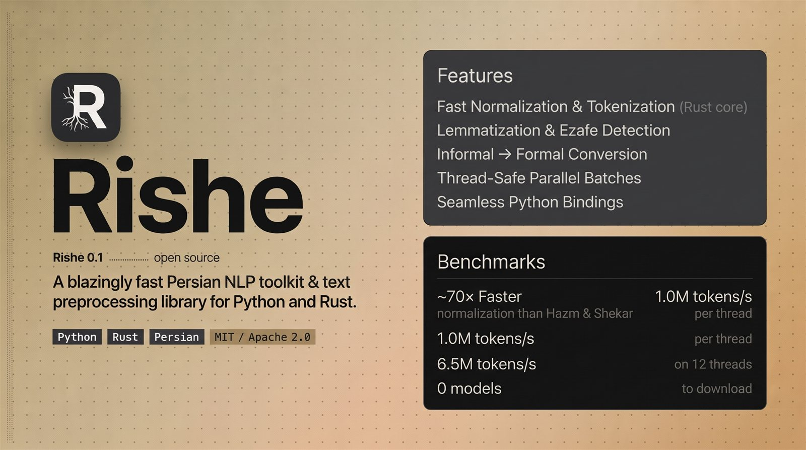

<p align="center">
  
</p>

<div dir="rtl" align="right">

# ریشه (Rishe)

**پردازش زبان فارسی با هسته‌ی Rust.**

ریشه متن خام فارسی را به داده‌ی ساخت‌یافته تبدیل می‌کند: متن نرمال‌شده،
توکن‌ها، جمله‌ها، لم‌ها، نشانه‌های اضافه، ریشه و شکل‌های صرفی. یک موتور واحد
برای پایتون و Rust.

## نصب

پایتون:

```bash
pip install rishe
```

Rust:

```bash
cargo add rishe
```

برنامه‌ی خط فرمان:

```bash
cargo install rishe
```

## شروع سریع

```python
import rishe

rishe.normalize("مي كنم")                     # 'می‌کنم'
rishe.tokenize("سلام دنیا")                    # ['سلام', 'دنیا']
rishe.lemmatize("می‌روم")                      # 'رفت'

text = "اون گفت فردا می‌ره کتابخونه و یه کتاب خوب می‌خونه."
rishe.process(text).tokens                     # توکن‌های نرمال‌شده، پایین را ببینید
rishe.process(text).formal_text                # 'آن گفت فردا می‌رود کتابخانه و یک کتاب خوب می‌خواند.'
```

توابع `normalize`، `tokenize` و `lemmatize` هرکدام یک مرحله را انجام می‌دهند
و به هیچ شیئی نیاز ندارند. `process` کل خط لوله را در یک فراخوانی اجرا می‌کند
(نرمال‌سازی، تبدیل محاوره‌ای به رسمی، توکن‌سازی، لم‌سازی، جمله‌بندی و اضافه) و
یک شیء نتیجه برمی‌گرداند که همه‌ی این خروجی‌ها را دارد؛ اگر چند خروجی از یک
اجرا می‌خواهید، یک بار آن را در متغیری نگه دارید:

```python
doc = rishe.process(text)
doc.tokens        # ['آن', 'گفت', 'فردا', 'می‌رود', 'کتابخانه', 'و', 'یک', 'کتاب', 'خوب', 'می‌خواند', '.']
doc.lemmas        # ['آن', 'گفت', 'فردا', 'رفت', 'کتابخانه', 'و', 'یک', 'کتاب', 'خوب', 'خواند', '.']
doc.formal_text   # 'آن گفت فردا می‌رود کتابخانه و یک کتاب خوب می‌خواند.'
```

مرحله‌های تک‌نفره‌ی دیگر هم تابع هم‌سطح ماژول دارند: `rishe.sent_tokenize`،
`rishe.mask`، `rishe.keywords` و `rishe.stem`. ساخت `Pipeline()` فقط برای
تنظیم بسته‌های مدل و متدهایی لازم است که تابع هم‌سطح ماژول ندارند
(`conjugate`، `rake`، `textrank`، `spell_correct`).

## امکانات

- نرمال‌سازی، توکن‌سازی واژه و جمله و لم‌سازی.
- ریشه‌یابی، صرف افعال، تصریف، جداسازی پی‌بند، تصحیح املایی و حذف ایست‌واژه.
- تشخیص اضافه و تبدیل نوشتار محاوره‌ای به رسمی.
- تبدیل و تشخیص تاریخ شمسی.
- امبدینگ‌های استاتیک fastText/word2vec و استخراج کلیدواژه.
- بسته‌های اختیاری POS، NER، اضافه‌ی آموخته‌شده و تجزیه‌ی وابستگی که جداگانه دانلود می‌شوند.

## بسته‌های مدل

```bash
rishe hub pull pos-compact
rishe hub pull ner-compact
rishe hub pull ezafe-compact
```

```python
from rishe import Pipeline, hub

pipe = Pipeline(
    pos_pack=hub.path("pos-compact"),
    ner_pack=hub.path("ner-compact"),
    ezafe_pack=hub.path("ezafe-compact"),
)

for token in pipe.pos("کتاب‌های خوب را به دوستانم می‌دهم."):
    print(token.text, token.tag)

for entity in pipe.ner("سرلشگر فیروزآبادی به پادشاه عربستان گفت."):
    print(entity.text, entity.label)
```

نصب پایه به مدل نیاز ندارد؛ بسته‌های مدل فقط وقتی لازم باشند دانلود می‌شوند.

## مستندات

- [راهنمای پایتون](https://github.com/MahdiAlikhah/rishe/blob/main/README.pypi.md)
- [راهنمای Rust](https://github.com/MahdiAlikhah/rishe/blob/main/README.crates.md)
- [API راهنمای](https://github.com/MahdiAlikhah/rishe/blob/main/docs/api.md)
- [CLI راهنمای](https://github.com/MahdiAlikhah/rishe/blob/main/docs/cli.md)
- [کلاس‌های سازگار](https://github.com/MahdiAlikhah/rishe/blob/main/docs/compat.md)
- [بنچمارک‌ها](https://github.com/MahdiAlikhah/rishe/blob/main/docs/BENCHMARKS.md)
- [کارت‌های مدل](https://github.com/MahdiAlikhah/rishe/blob/main/docs/MODEL_CARDS.md)
- [README انگلیسی](https://github.com/MahdiAlikhah/rishe/blob/main/README.md)

## مجوز

انتشار تحت [Apache-2.0](https://github.com/MahdiAlikhah/rishe/blob/main/LICENSE-APACHE)
یا [MIT](https://github.com/MahdiAlikhah/rishe/blob/main/LICENSE-MIT)، به انتخاب شما.
اطلاعات منابع واژگان در
[NOTICE.md](https://github.com/MahdiAlikhah/rishe/blob/main/NOTICE.md) آمده است.

ساخته‌شده توسط مهدی علی خواه.

</div>
