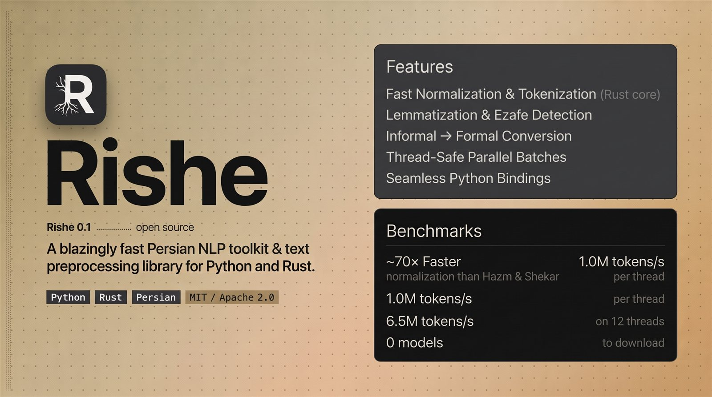

<p align="center">
  
</p>

# Rishe (ریشه)

**Fast Persian NLP and morphology, built in Rust.**

<p align="center">
  <a href="https://pypi.org/project/rishe/"></a>
  <a href="https://pepy.tech/projects/rishe"></a>
  <a href="#license"></a>
</p>

<p align="center">
  <a href="README.fa.md">فارسی</a> ·
  <a href="README.pypi.md">Python</a> ·
  <a href="README.crates.md">Rust</a>
</p>

Rishe turns raw Persian text into clean, structured data: normalized text,
tokens, sentences, lemmas, ezafe markers, stems, verb forms, spell suggestions
and optional POS/NER tags or dependency trees. One engine, prebuilt Python
wheels and a Rust crate.

## Choose your entry point

- **Python** — `pip install rishe` (CPython 3.9 – 3.14, no Python dependencies).
  Read [README.pypi.md](README.pypi.md) or the [PyPI page](https://pypi.org/project/rishe/).
- **Rust** — `cargo add rishe` (Rust 1.88+; model packs need 1.91), or
  `cargo install rishe` for the CLI. Read [README.crates.md](README.crates.md)
  or the [crates.io page](https://crates.io/crates/rishe).

## Supported versions

Each row below was measured on the published artifacts, not assumed: the
interpreters and toolchains were installed and run. CI rebuilds the Python
package on every listed CPython version and enforces the Rust 1.88 gate on every
push.

| | works on | older than that |
|---|---|---|
| CPython wheel | 3.9 – 3.14 | `pip` refuses: `No matching distribution found` (the wheel is tagged 3.9+, `Requires-Python >=3.9`) |
| Rust, default and `python` features | 1.88 and newer | `cargo` refuses: `icu_collections@2.4.0 requires rustc 1.88` |
| Rust, `models` feature | 1.91 and newer | `cargo` refuses: `tract@0.23.9 requires rustc 1.91` |

Free-threaded CPython (`3.13t`, `3.14t`) and PyPy have no wheel and are not
supported. Building the Python package from source needs Rust 1.91, because the
wheel enables the `models` feature. Platform and architecture support is in
[docs/STABILITY.md](docs/STABILITY.md).

## Quick start

```python
import rishe

rishe.normalize("مي كنم")                     # 'می‌کنم'
rishe.tokenize("سلام دنیا")                    # ['سلام', 'دنیا']
rishe.lemmatize("می‌روم")                      # 'رفت'

text = "اون گفت فردا می‌ره کتابخونه و یه کتاب خوب می‌خونه."
rishe.process(text).tokens                     # ['آن', 'گفت', 'فردا', 'می‌رود', 'کتابخانه', 'و', 'یک', 'کتاب', 'خوب', 'می‌خواند', '.']
rishe.process(text).formal_text                # 'آن گفت فردا می‌رود کتابخانه و یک کتاب خوب می‌خواند.'
```

`normalize`, `tokenize` and `lemmatize` are single steps: no object needed.
`process` runs the whole pipeline in one call — normalization, colloquial →
formal rewriting, tokenization, lemmatization, sentence splitting and ezafe —
and returns a result object with all of those fields:

```python
doc = rishe.process(text)   # one run, every field
doc.lemmas                  # ['آن', 'گفت', 'فردا', 'رفت', 'کتابخانه', 'و', 'یک', 'کتاب', 'خوب', 'خواند', '.']
```

`Pipeline(...)` is not required for any of this. It stays for configuration
(model packs, normalizer flags) and for the methods that have no module-level
function.

More Python usage is in [README.pypi.md](README.pypi.md); the Rust API is in
[README.crates.md](README.crates.md). Persian readers can start with
[README.fa.md](README.fa.md).

## What it does

- Normalization, word/sentence tokenization, lemmatization, stemming, verb
  conjugation and inflection.
- Colloquial → formal rewriting, clitic splitting, spell correction, stopword
  removal, ezafe detection and Jalali date parsing.
- Static fastText/word2vec embeddings, loaded and pooled in-process.
- Optional POS, NER, learned ezafe and dependency-parsing packs, downloaded
  separately and run without ONNX Runtime or a Python ML stack.
- Drop-in class API (`rishe.compat`): `Normalizer`, `WordTokenizer`,
  `SentenceTokenizer`, `Lemmatizer`, `Stemmer` and `TokenSplitter`, no lexicon
  files and no Python dependencies.

## Embeddings

```bash
rishe hub pull rishe-embed-fa-300-v2   # 42 MB, checksum-verified
```

```python
from rishe import Embeddings, hub

vectors = Embeddings(hub.path("rishe-embed-fa-300-v2"))
print(vectors.dim, len(vectors), vectors.dtype)
vectors.most_similar("کتاب", 5)
vectors.sentence_similarity("این کتاب خوب است", "کتاب خوبی بود")
```

`rishe-embed-fa-300-v2` is a 300-dimensional, 68,144-word Word2Vec skip-gram
model trained on 150,000 Persian Wikipedia articles. The hub serves the compact
`.rvec` file, which stores the same matrix as IEEE 754 binary16; `rishe convert`
rewrites any word2vec `.vec` file that way, and `Embeddings` reads both formats
without extra options. The 0.9.x 30,000-article pack stays available as
`rishe-embed-fa-300`. The vectors are CC BY-SA 4.0; see [NOTICE.md](NOTICE.md).

## Architecture

- **Rust core** — normalization, tokenization, morphology, embedding math and
  the optional pack runtime.
- **Python interface** — abi3 wheels over the same core; no Python runtime
  dependencies.
- **Optional model packs** — POS, NER, ezafe and dependency parsing are
  separate downloads; the base install stays model-free.

## Performance & benchmarks

The core, feature and model-pack benchmarks live in the docs:

[Core engine](docs/BENCHMARKS.md) · [Feature comparisons](docs/FEATURE_BENCHMARKS.md) · [Model packs](docs/MODEL_BENCHMARKS.md) · [Model cards](docs/MODEL_CARDS.md)

## Docs

- [API](docs/api.md) · [CLI](docs/cli.md) · [Drop-in classes](docs/compat.md)
- [Exit codes](docs/errors.md) · [Serve protocol](docs/serve-schema.md) · [Stability](docs/STABILITY.md)

## License

Dual-licensed under [Apache-2.0](LICENSE-APACHE) or [MIT](LICENSE-MIT).
Lexicon attributions are in [NOTICE.md](NOTICE.md).

The code license does not cover downloaded model weights: the
`rishe-embed-fa-300-v2` vectors are released under CC BY-SA 4.0, and each
optional task pack carries its own terms. See [NOTICE.md](NOTICE.md).

Built by Mahdi Alikhah.
