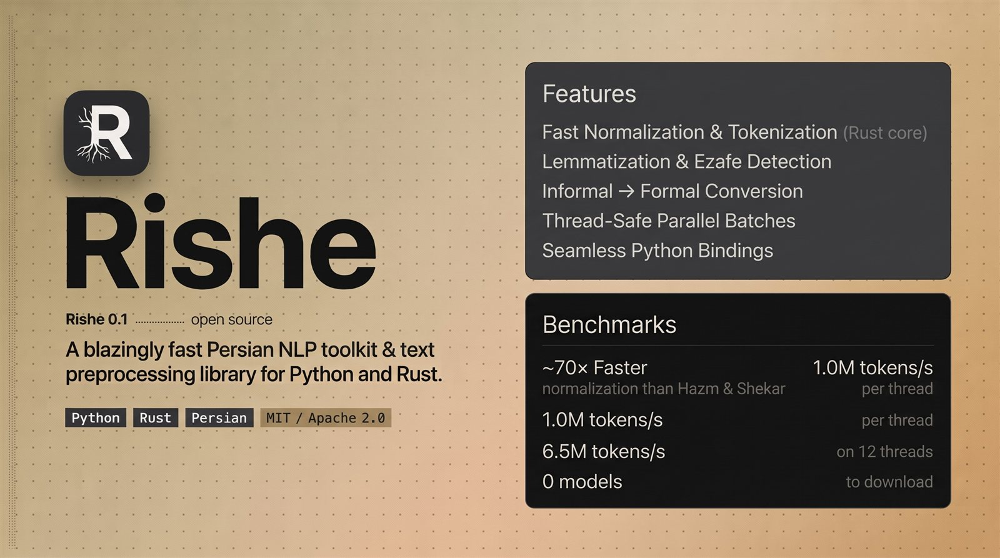

<p align="center">
  
</p>

# Rishe (ریشه)

Fast Persian NLP and morphology for Python. Prebuilt wheels, no Python
dependencies, and the base pipeline needs no model downloads.

<p align="center">
  <a href="https://pepy.tech/projects/rishe">
    
  </a>
</p>

[Persian README](https://github.com/MahdiAlikhah/rishe/blob/main/README.fa.md)

## Install

```bash
pip install rishe
```

Python 3.9+. Linux (glibc and musl), macOS and Windows wheels are published.

## Quickstart

```python
from rishe import Pipeline

pipe = Pipeline()
doc = pipe("اون گفت فردا می‌ره کتابخونه و یه کتاب خوب می‌خونه.")

print(doc.tokens)
# ['آن', 'گفت', 'فردا', 'می‌رود', 'کتابخانه', 'و', 'یک', 'کتاب', 'خوب', 'می‌خواند', '.']
print(doc.lemmas)
# ['آن', 'گفت', 'فردا', 'رفت', 'کتابخانه', 'و', 'یک', 'کتاب', 'خوب', 'خواند', '.']
print(doc.formal_text)
# 'آن گفت فردا می‌رود کتابخانه و یک کتاب خوب می‌خواند.'
```

`pipe.normalize`, `pipe.tokenize`, `pipe.sent_tokenize`, `pipe.lemmatize`,
`pipe.stem`, `pipe.conjugate`, `pipe.spell_correct` and the rest are methods on
the same object. `pipe(text)` runs the whole pipeline. `pipe.tokenize(text)` is
the tokenizer alone: it returns surface tokens and does not normalize — call
`pipe.normalize` first, or use `pipe(text).tokens`, for normalized tokens.

Most of them are also module-level functions, so the common cases need no
object at all:

```python
import rishe

rishe.normalize("مي كنم")        # 'می‌کنم'
rishe.tokenize("سلام دنیا")       # ['سلام', 'دنیا']
rishe.sent_tokenize("یک. دو.")    # ['یک.', 'دو.']
rishe.mask(text, maskers=["url", "email"])
rishe.keywords(text, n=5)         # RAKE key phrases
```

## Class-based API

The drop-in class API lives in `rishe.compat` (the same classes are exported
from the package root):

```python
from rishe.compat import (
    Lemmatizer,
    Normalizer,
    SentenceTokenizer,
    Stemmer,
    TokenSplitter,
    WordTokenizer,
    sent_tokenize,
    word_tokenize,
)

Normalizer().normalize("مي كنم")             # 'می‌کنم'
WordTokenizer().tokenize("رفته است")         # ['رفته_است']
SentenceTokenizer().tokenize("یک. دو.")
Lemmatizer().lemmatize("می‌روم")              # 'رفت#رو'
Stemmer().stem("کتاب‌ها")                    # 'کتاب'
TokenSplitter().split_token_words("بهش")     # [('به', 'او')]

word_tokenize("رفته است")                    # ['رفته_است']
sent_tokenize("یک. دو.")
```

No lexicon paths are needed: the classes use Rishe's compiled-in lexicons.
`WordTokenizer` accepts the same options as the pipeline tokenizer
(`join_verb_parts`, `replace_emails`, `replace_links`, and so on).

## Features

- Normalization, tokenization, sentence splitting and lemmatization.
- Stemming, conjugation, inflection, clitic splitting, spell correction,
  stopwords and ezafe detection.
- Jalali date parsing, formatting and Gregorian conversion.
- Static fastText/word2vec embeddings with sentence pooling.
- Drop-in class API (`rishe.compat`): `Normalizer`, `WordTokenizer`,
  `SentenceTokenizer`, `Lemmatizer`, `Stemmer` and `TokenSplitter`.
- Optional POS, NER, learned ezafe and dependency-parsing model packs.

## Feature tour

### Morphology and utilities

```python
pipe.stem("کتاب‌ها")                      # 'کتاب'
pipe.conjugate("رفت")["present"][:3]      # ['می‌روم', 'می‌روی', 'می‌رود']
pipe.comparative("بزرگ")                  # 'بزرگ‌تر'
pipe.superlative("بزرگ")                  # 'بزرگ‌ترین'
pipe.plural("کتاب")                       # 'کتاب‌ها'
pipe.possessive("خانه", 0)                # 'خانه‌ام'
pipe.split_token("بهش")                   # ['به', 'او']
pipe.spell_correct("سسلام بر ششما")       # 'سلام بر شما'
pipe.tokenize_spans("سلام دنیا")          # [('سلام', 0, 4), ('دنیا', 5, 9)]
```

### Normalization and masking

`normalize(text, stages=[...])` applies individual operators in the order you
list them; `mask(text, maskers=[...])` removes or masks URLs, emails, mentions,
hashtags, HTML, digits, diacritics, punctuation, stopwords, offensive words and
non-Persian text.

```python
pipe.normalize("﷽ 1𝟮3٤٥⓺", stages=["arabic_unicode", "digits"])
# 'بسم الله الرحمن الرحیم ۱۲۳۴۵۶'

pipe.mask("سلام @user، به https://rishe.dev یا info@rishe.dev بنویس.",
          maskers=["url", "email", "mention"])
# 'سلام   به <URL> یا <EMAIL> بنویس.'
```

### Utilities, keywords and transliteration

```python
pipe.number_to_words(1404)                 # 'یک هزار و چهارصد و چهار'
pipe.ngrams("این یک متن", 1, 2)             # ['این', 'یک', 'متن', 'این یک', 'یک متن']
pipe.persianize("فایل را با کامپیوتر باز کن")  # 'پرونده را با رایانه باز کن'
pipe.rake(text, n=5)
pipe.textrank(text, n=5)
pipe.to_tajik("خانه")                      # 'хона'
pipe.to_persian("хона")                    # 'خانه'
```

`keyboard_noise`, `ocr_noise` and `whitespace_noise` add reproducible typing, OCR
and spacing noise; pass `seed=` for deterministic output.

### Jalali dates

```python
from rishe import JalaliDate, parse_date

date = parse_date("۱۲ مرداد ۱۴۰۲")        # JalaliDate(1402, 5, 12)
date.iso                                   # '2023-08-03'
date.to_gregorian()                        # (2023, 8, 3)
date.format_persian()                      # '۱۲ مرداد ۱۴۰۲'

JalaliDate.from_gregorian(2023, 8, 3)      # JalaliDate(1402, 5, 12)
```

### Tokenizer options

```python
pipe.tokenize("رفته است", join_verb_parts=True)   # ['رفته_است']
pipe.tokenize("info@a.co", replace_emails=True)   # ['EMAIL']
```

Options include `join_verb_parts`, `join_abbreviations`, `separate_emoji`,
`replace_links`, `replace_ids`, `replace_emails`, `replace_numbers` and
`replace_hashtags`.

### Corpora

```python
from rishe import ConlluReader, PeymaReader, PlainTextReader

for sentence in ConlluReader("data/corpora/fa_perdt-ud-test.conllu"):
    print(sentence.text, sentence.tokens[0].lemma)
```

`ConlluReader` handles CoNLL-U, `PeymaReader` reads the PEYMA format and
`PlainTextReader` reads one sentence per line.

## Model packs

POS, NER, ezafe and dependency parsing are separate, checksum-verified
downloads. They run inside the package without ONNX Runtime or a Python ML
stack. The depparse pack is `depparse-compact` and carries its own CC BY-SA
4.0 notice.

```bash
rishe hub pull pos-compact
rishe hub pull ner-compact
rishe hub pull ezafe-compact
rishe hub pull depparse-compact
```

```python
from rishe import Pipeline, hub

pipe = Pipeline(
    pos_pack=hub.path("pos-compact"),
    ner_pack=hub.path("ner-compact"),
    ezafe_pack=hub.path("ezafe-compact"),
)

for token in pipe.pos("کتاب‌های خوب را به دوستانم می‌دهم."):
    print(token.text, token.tag, token.start, token.end)

for entity in pipe.ner("سرلشگر فیروزآبادی به پادشاه عربستان گفت."):
    print(entity.text, entity.label, entity.start, entity.end)

for token in pipe.ezafe("کتابخانه مرکزی دانشگاه شریف"):
    print(token.text, token.tag, token.start, token.end)

parser = Pipeline(depparse_pack=hub.path("depparse-compact"))
for item in parser.depparse("کتاب‌های خوب را به دوستانم می‌دهم."):
    print(item.text, item.head, item.relation)

pipe.pos_batch(["کتاب‌های خوب", "خوب است"])
pipe.ner_batch(["فیروزآبادی گفت.", "عربستان جای خوبی است."])
pipe.ezafe_batch(["کتابخانه مرکزی", "دانشگاه شریف"])
```

`TaggedToken` has `text`, `tag`, `start` and `end`; `Entity` has `text`,
`label`, `start` and `end`; `Dependency` has `text`, `head`, `relation`,
`start` and `end`. Start/end are character offsets; `head` is zero-based or
`None` for the root. The lower-level
`ModelPack` class is still available when you want one task:

```python
from rishe import ModelPack, hub

pack = ModelPack(hub.path("pos-compact"))
pack.tags("کتاب‌های خوب")   # typed TaggedToken list
pack.tags_from_words(["کتاب‌های", "خوب"])  # tuple output
```

## Embeddings

```bash
rishe hub pull rishe-embed-fa-300-v2   # 42 MB, checksum-verified
```

```python
from rishe import Embeddings, hub

emb = Embeddings(hub.path("rishe-embed-fa-300-v2"))
emb.dim, len(emb), emb.dtype           # 300, 68144, 'f16'
emb.vector("کتاب")                     # list[float] or None
emb.similarity("کتاب", "خوب")           # cosine similarity
emb.sentence_vector("این کتاب خوب است") # mean of in-vocab token vectors
emb.sentence_similarity("این کتاب خوب است", "کتاب خوبی بود")
emb.most_similar("کتاب", 5)            # [(word, cosine), ...]
```

`rishe-embed-fa-300-v2` is the first-party model: 300 dimensions, 68,144 words,
trained on 150,000 Wikipedia articles. The hub serves the compact binary `.rvec`
file, which stores IEEE 754 binary16 values and decodes them back to `f32` on
load; the same matrix is also published as word2vec text, and `Embeddings`
accepts either file. The 0.9.x 30,000-article pack remains available as
`rishe-embed-fa-300`, and
[`hazm-fasttext-300`](https://huggingface.co/roshan-research/hazm-word-embedding)
is still downloadable as a larger external comparison model. The vectors are
CC BY-SA 4.0; see [NOTICE.md](NOTICE.md).

## CLI

```bash
rishe normalize "مي كنم"
rishe tokenize "سلام دنیا" --json
rishe pos "کتاب‌های خوب را به دوستانم می‌دهم."
rishe ner --json "سرلشگر فیروزآبادی به پادشاه عربستان گفت."
rishe ezafe "کتابخانه مرکزی دانشگاه شریف"
rishe depparse --pack path/to/depparse "کتاب‌های خوب را به دوستانم می‌دهم."
rishe similar کتاب --top 5
rishe similarity کتاب خوب
rishe hub info pos-compact
rishe hub verify pos-compact
rishe hub remove pos-compact
```

## Docs

- [API](https://github.com/MahdiAlikhah/rishe/blob/main/docs/api.md)
- [CLI](https://github.com/MahdiAlikhah/rishe/blob/main/docs/cli.md)
- [Drop-in classes](https://github.com/MahdiAlikhah/rishe/blob/main/docs/compat.md)
- [Exit codes](https://github.com/MahdiAlikhah/rishe/blob/main/docs/errors.md)
- [Serve protocol](https://github.com/MahdiAlikhah/rishe/blob/main/docs/serve-schema.md)
- [Stability](https://github.com/MahdiAlikhah/rishe/blob/main/docs/STABILITY.md)
- [Benchmarks](https://github.com/MahdiAlikhah/rishe/blob/main/docs/BENCHMARKS.md)
- [Model-pack benchmarks](https://github.com/MahdiAlikhah/rishe/blob/main/docs/MODEL_BENCHMARKS.md)
- [Model cards](https://github.com/MahdiAlikhah/rishe/blob/main/docs/MODEL_CARDS.md)
- [GitHub repository](https://github.com/MahdiAlikhah/rishe)

## License

Dual-licensed under
[Apache-2.0](https://github.com/MahdiAlikhah/rishe/blob/main/LICENSE-APACHE) or
[MIT](https://github.com/MahdiAlikhah/rishe/blob/main/LICENSE-MIT), at your
option. Lexicon attributions are in
[NOTICE.md](https://github.com/MahdiAlikhah/rishe/blob/main/NOTICE.md).

The code license does not cover downloaded model weights. The
`rishe-embed-fa-300-v2` vectors are released under CC BY-SA 4.0, and each
optional task pack carries its own terms; see
[NOTICE.md](https://github.com/MahdiAlikhah/rishe/blob/main/NOTICE.md).

Built by Mahdi Alikhah.
